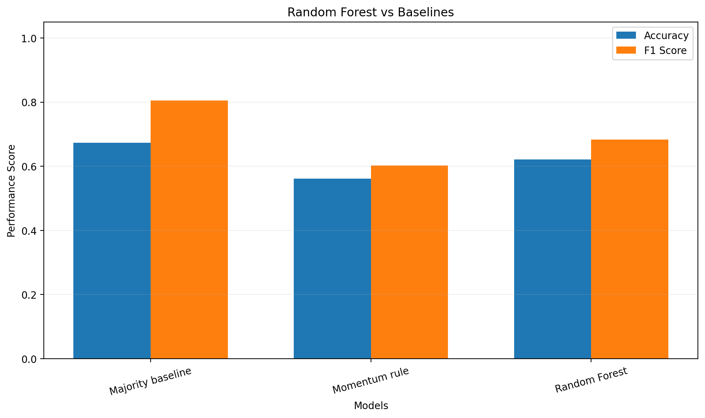
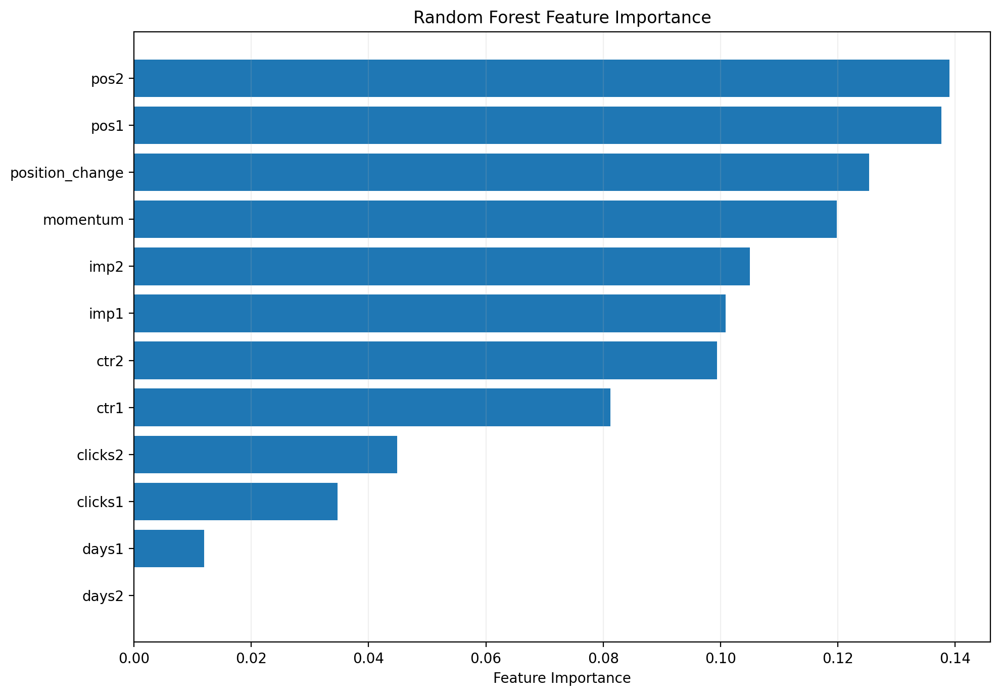
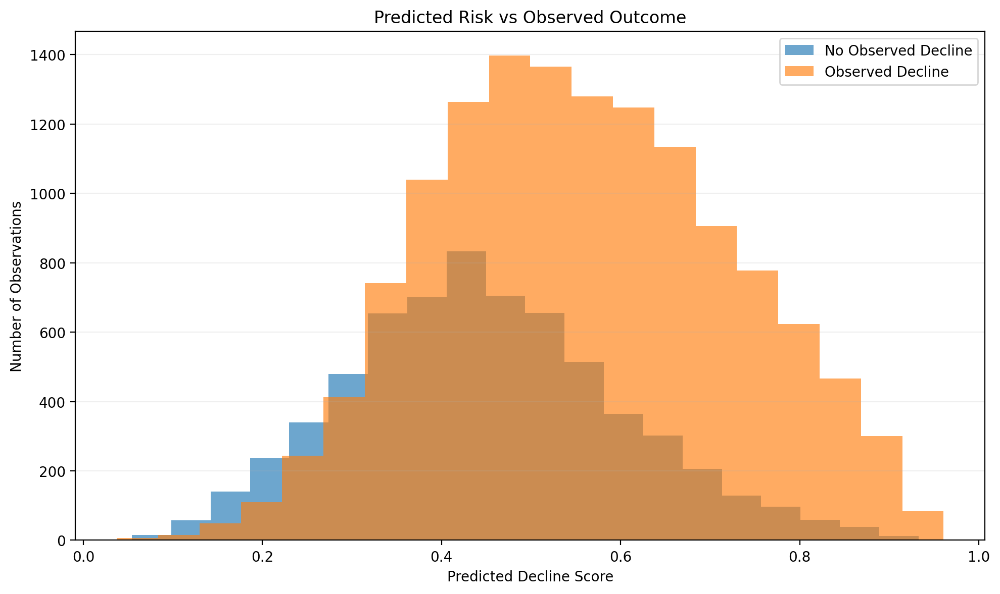

# Predicting Organic Search Visibility Decline Using Machine Learning

## 1. Abstract

This research investigates whether historical organic search
performance can identify content at risk of future visibility
decline.

The study uses the pseudonymized FlyRank internship warehouse,
containing approximately 78.8 million daily performance records.

Historical search features were engineered using DuckDB,
and a Random Forest classifier was evaluated on held-out clients.

The model achieved 62.2% accuracy compared with
67.3% for the majority-class baseline.

The research supports content-review prioritization
rather than causal conclusions about search rankings.

## 2. Introduction and Research Question

Content teams manage large numbers of pages with limited
resources for performance investigation.

This study addresses the following question:

Can historical organic search performance signals predict
whether a content item will experience a decline exceeding
20% in impressions during the following 30 days?

The intended decision is a prioritized content-review queue.

## 3. Data

Source: FlyRank Internship Warehouse.

The published warehouse contains approximately
78.8 million daily performance records.

Historical observation windows:

- March 3 to April 1, 2026.
- April 2 to May 1, 2026.

Future outcome window:

- May 2 to May 31, 2026.

Eligible content observations: 88,272.

Eligible pseudonymized clients:
38.

Content items require at least 100 impressions in each
historical window, five reporting days in each historical
window, and five reporting days in the outcome window.

The experiment excludes low-traffic items, records with
insufficient reporting coverage, and potentially overlapping
query-level snapshots.

June 2026 remains outside model development.

Client names, website URLs, raw queries, and authentication
tokens are excluded from public outputs.

## 4. Methodology

The problem is formulated as binary classification.

The target represents a future impression decline
greater than 20%.

Historical features include:

- Search impressions.
- Search clicks.
- Click-through rates.
- Average search positions.
- Historical momentum.
- Position change.
- Reporting-day coverage.

Random Forest is the main classifier.

The two baselines are:

1. Majority-class prediction.
2. Historical momentum rule.

GroupShuffleSplit is used to separate entire clients
between training and testing.

Training observations: 68,269.

Testing observations: 20,003.

Random seed: 42.

Future outcome measurements and client identifiers
are excluded from model features.

## 5. Results

Observed test decline rate: 67.3%.

| Model | Accuracy | Precision | Recall | F1 |
|---|---:|---:|---:|---:|
| Majority baseline | 0.673 | 0.673 | 1.000 | 0.805 |
| Momentum rule | 0.561 | 0.771 | 0.495 | 0.603 |
| Random Forest | 0.622 | 0.783 | 0.605 | 0.683 |

Random Forest ROC-AUC: 0.683.

Average precision: 0.810.

Precision@20: 1.000.

Accuracy difference versus majority baseline:
-5.1%.

All approaches were evaluated on the same held-out
client observations.

### Figure 1 - Model Comparison

### Figure 2 - Feature Importance

The three highest-ranked features were:
pos2, pos1, position_change.

Feature importance does not establish causality.

### Figure 3 - Predicted Risk Distribution

## 6. Limitations

This study uses observational data and cannot establish
that any specific content intervention will improve
organic search performance.

The eligibility criteria exclude low-traffic items
and content with insufficient future reporting coverage.

Complete disappearance from search reporting may
therefore be underrepresented.

The main validation uses one historical cutoff
and a client-grouped holdout.

Repeated temporal backtesting and prospective evaluation
were not performed.

Search demand, seasonality, competition, indexing,
and reporting differences may affect measured outcomes.

Predicted model scores are not independently calibrated.

The research supports human decision-making,
not automatic content modification.

## 7. Ranked Recommendations

The trained model provides a ranking of content items
according to estimated future decline risk.

Priority 1:

Investigate high-risk content with negative
historical impression momentum.

Priority 2:

Review content with deteriorating average search positions.

Priority 3:

Investigate content freshness, topical relevance,
and search intent for other high-risk pages.

The top-20 observations achieved Precision@20
of 1.000.

The overall held-out decline rate was
0.673.

These recommendations identify investigation priorities,
not guaranteed methods for increasing traffic.

## 8. Reproducibility

Project repository:

https://github.com/mohamedmorsy-ai/flyrank-ml-internship

Notebook location:

work/notebooks/capstone.ipynb

Environment:

- Google Colab
- Python
- DuckDB
- Pandas
- NumPy
- Scikit-learn
- Matplotlib

Random seed: 42.

Reproduction requires authorized access to the
FlyRank internship warehouse.

Private client data and authentication credentials
are not included in public artifacts.

## 9. Acknowledgments & Data Credit

This research was developed as part of the
FlyRank Machine Learning Internship.

The pseudonymized internship warehouse
was provided by FlyRank for educational analysis.

Official website:

https://flyrank.ai

The findings reflect an independent internship
research exercise and are limited to the
observed data and validation design.